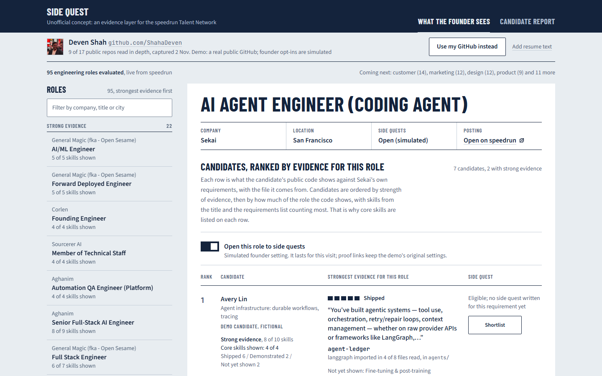
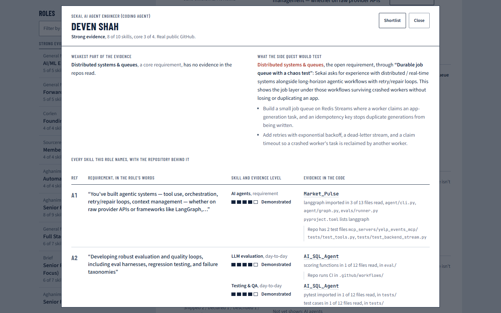
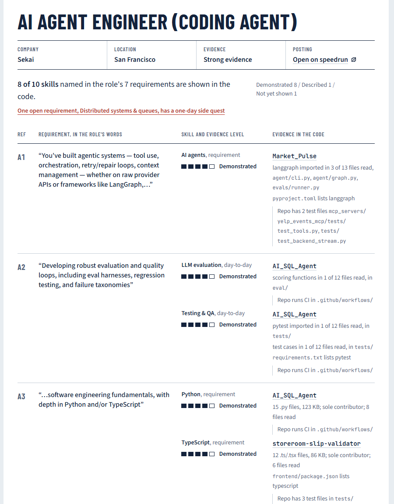
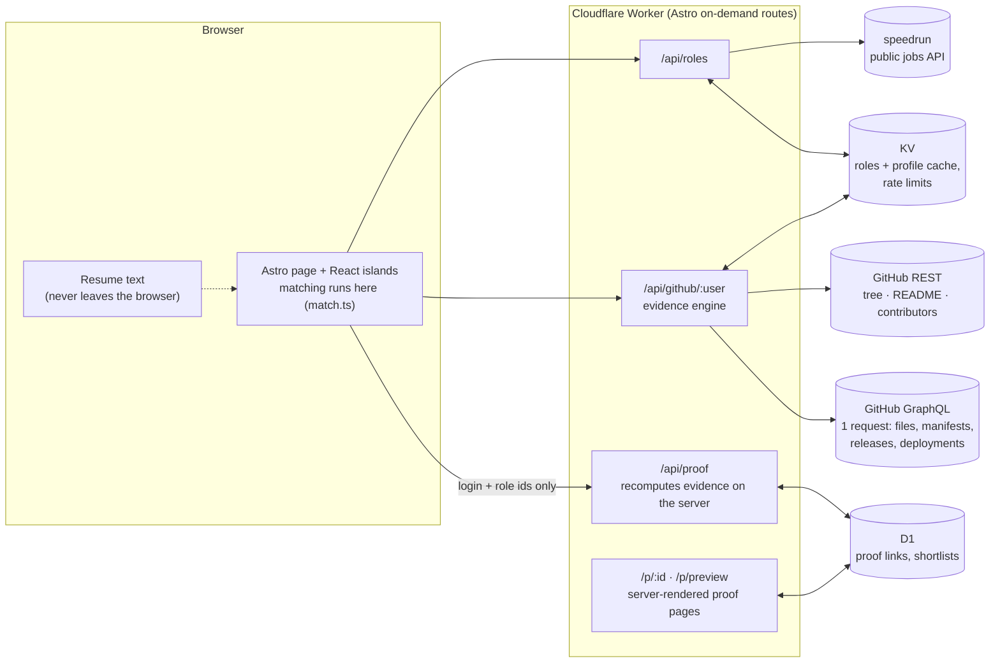

# Side Quest

**An evidence layer for the speedrun Talent Network.** Side Quest reads a candidate's public GitHub, checks it
against each live speedrun engineering role in the founder's own words, and shows the files behind every claim.
When a founder has opened a role to it and the evidence is already strong, it offers a one-day *side quest* that
closes the single requirement the code doesn't show yet.

**Live:** https://side-quest.deven-rshaha.workers.dev/?demo=1 (opens on what a founder sees; no sign-in)

> An unofficial concept I built for my application to the a16z speedrun talent team's Product Engineer role. It is
> not affiliated with or endorsed by a16z or speedrun. It uses speedrun's public jobs API and links back to every
> posting. Founder opt-ins and the six other candidates in the founder view are simulated, and labelled as such.



---

## Why I built this

Job hunting is broken on both sides in the same place: **a resume is a claim, and nobody can check it quickly.**

- **Candidates** already have the evidence: projects, repos, tests, deploys. But it sits unread, because no founder
  has time to open nine repos and work out which file answers which requirement.
- **Founders** compensate with take-home assignments. Those cost the candidate unpaid days, usually before anyone has
  looked at work they have already done, and they often end in silence.
- **The talent team** sits between the two and has to decide who to introduce to whom, mostly from self-reported text.

I've lived the candidate side of this. This autumn I built small, company-specific projects for startups I wanted to
work with (`storeroom-slip-validator` is one of them). The work existed, but there was nowhere to put it where a
founder would see, in their own terms, which part of it answered what they were asking for.

My first idea was the obvious one: generate a custom build-to-sell project for every role. I dropped it. Unsolicited,
AI-generated take-homes are noise for founders and a treadmill for candidates. Side Quest is the version I'd trust on
both sides:

1. **Start from work that already exists.** Read the code, not the resume.
2. **Answer the founder's requirements, in their words**, with a file path for every answer and no single score.
3. **Make the extra work small, invited and earned.** A side quest appears only when the founder opted in *and* the
   existing evidence is already strong. It targets one open requirement, takes at most a day, and stays the
   candidate's to share even if that founder passes.

## The five-minute walkthrough

| Step | Open | What you're looking at |
|---|---|---|
| 1 | [`/?demo=1`](https://side-quest.deven-rshaha.workers.dev/?demo=1) | **What the founder sees** for Sekai's AI Agent Engineer role: seven candidates ranked by evidence for *this* role. One is my real public GitHub; six are fictional and labelled. A fictional agent-infrastructure candidate ranks above me, and the ranking isn't tuned to make me win. |
| 2 | **Inspect all 10 skills** on any row | A sheet opens over the shortlist: every requirement with its level and repository, the weakest part of the evidence, and what the side quest would test. Shortlist from inside it; Esc closes it. |
| 3 | **Candidate report** tab | The same role from my side: each founder sentence, the skills it names, the evidence level, and the files that show it. |
| 4 | The red row and **Side quest** section | The one open requirement (distributed systems) and the one-day brief that closes it. |
| 5 | **Preview the page first**, under *Send this report* | The proof link a founder would receive: one company only, the same evidence recomputed on the server, nothing saved. |
| 6 | **Open this role to side quests** (founder view) | Toggle a founder's opt-in and watch the side-quest state change on both sides. |



## What the role asks for, and where it shows up here

The posting asks for one person who can take an idea all the way to a live product.

| The role asks | In this project |
|---|---|
| **Product:** spot what's broken for job seekers and decide what's worth building | The problem above, the build-to-sell idea I dropped, and the side-quest gate (invited, earned, targeted) instead of generated take-homes. Three users, each with their own view: candidate report, founder view, talent-team link. |
| **Design:** taste, and it looks and feels right | A report, not a dashboard: founder requirements in quotes, file paths in mono, five ruled cells per skill, red used only for the open requirement. No match percentages, no scores, no badges. [Design system](docs/design-system.md). |
| **Ship:** get it live, deployment included, using AI tools to move fast | Deployed on Cloudflare Workers from GitHub, with D1 and KV. Built with Claude Code as my pair. The side-quest briefs were generated with Claude Haiku for **$0.039 in total**, then hand-edited and reviewed. |
| **Lived it:** you've been a job seeker recently | [Why I built this](#why-i-built-this). |
| **Job hunting sux: tools useful to job seekers, not ads** | Unofficial and labelled. Resume text never leaves the browser. A role link names exactly one company. Simulated things say so. Old proof links say when stricter rules replaced the ones they were read under. |

It also sits next to the products the posting cites rather than copying them. career-ops and Tsenta score jobs
against a CV. Juicebox and Paraform help founders source. Jack & Jill give each side its own agent. Side Quest is the
piece between them: **evidence from the work itself, readable by both sides**, built on speedrun's own jobs API and
pointing candidates to [the Talent Network](https://speedrun-talent-network.com/join/).

## Evidence levels

Every level claims only what was actually checked, and every claim shows its source.

| Level | Means | Example reason in the UI |
|---|---|---|
| **Mentioned** | A repo tag, the repo language, the description or a resume line names it | `tagged ai-agents` |
| **Described** | The README talks about it | `README: "Hybrid search retriever: BM25 + semantic search…"` |
| **Declared** | A dependency file lists it, or matching files exist, but no file that was read shows it in use | `pyproject.toml lists fastmcp`, with the note *Not seen in use in the 12 files read* |
| **Demonstrated** | Files that were read use it: they import its package, or contain its own code (SQL statements, a Dockerfile's `FROM`, scoring functions in `evals/`). A language needs ≥ 5 files and ≥ 20 KB of the candidate's own code (sole contributor, or ≥ 50% of commits) | `langgraph imported in 3 of 13 files read, agent/graph.py…` |
| **Shipped** | Demonstrated, plus a GitHub release, a successful GitHub deployment or a GitHub Pages site | `4 GitHub releases, latest v0.6.0` |

- **Tests, CI, a deploy URL and ownership are notes.** They're shown beside the evidence and never raise a level.
  "Tested:" appears only when a test file that was read imports the same package.
- **Shipped is a bonus.** Many good projects are never deployed because hosting costs money. Demonstrated counts in
  full toward Strong, no URL is ever pinged, and free hosts (Vercel, Netlify, Cloudflare) already record their deploys
  on GitHub.
- **A resume can only ever reach Mentioned.** It's the self-reported claim this product exists to get past.

These rules were tightened after an outside review found the first version too generous: a listed dependency used to
count as Demonstrated, and any test file used to count as Shipped. Links created under the old rules keep their
evidence and now say so.



## Matching and the side-quest gate

**Requirements.** Each role description is split into sections. Every skill in a ~35-skill engineering taxonomy is
weighted by where the founder wrote it: title +3 · requirements +2 · responsibilities or stack +1 · nice-to-have +0.5 ·
+1 per extra mention (up to 3). Skills named only in an "about the company" section are ignored when the description
has real sections.

**Strength per role** is a label, never a percentage, and it is always shown next to its breakdown
(for example *Demonstrated 8 / Described 1 / Not yet shown 1*):

- **Strong:** ≥ 70% of the requirement weight is Demonstrated or Shipped, **and** the role names ≥ 3 specific skills,
  **and** ≥ 2 core requirements (from the title or the requirements list) are covered. The last two rules stop thin
  descriptions from reading as Strong on generic Python and LLM matches.
- **Some:** weighted credit ≥ 30% (Mentioned 0.15 · Described 0.4 · Declared 0.6 · Demonstrated or Shipped 1).
- **Thin:** below that.

When a role isn't Strong, the report says why ("too few readable skills", "mostly day-to-day items, not the core
requirements").

**A side quest unlocks only when all three hold:** the founder opted the role in, the candidate's evidence is Strong,
and there's a real open requirement. It targets an open requirement from the role's own sections, never one named only in the company description. Every brief
was generated from the job description alone, then hand-edited and reviewed. Only briefs marked reviewed reach the UI.

## What's real and what's simulated

| Real | Simulated (and labelled) | Not built |
|---|---|---|
| Live speedrun engineering roles via the public API, with a bundled snapshot fallback | Founder opt-ins to side quests (4 roles) | Sign-in, saved profiles, accepting and submitting side quests |
| Live GitHub reads of any public account, cached for 6 hours | The six other candidates in the founder view (fictional people and repos) | Real founder accounts |
| The evidence engine, matching and side-quest gate | The founder's shortlist (stored per browser in D1, as a demo board) | Functions beyond engineering |
| Proof links: stored, shareable, deletable with a one-time link | | |
| 13 reviewed side-quest briefs | | |

Nothing on the site claims users, metrics or endorsements it doesn't have. The impact measures in the roadmap are
proposals, not results.

## Architecture



- **Within the free plan's 50 outbound requests per call.** A profile read costs 1 user + 1 repo list + 3 per repo
  (9 repos) + 1 GraphQL request for every repo's sample files (up to 8 source, 2 test and 3 config files each),
  manifests and delivery records. Without a token, manifests come over REST and no code is read, so nothing can pass
  Declared: an honest ceiling, not a guess.
- **The browser never sends evidence.** Creating a proof link sends only a GitHub login and role ids. The server
  rereads GitHub and rebuilds the document, so a page can't be edited to claim more. A role link must name exactly one
  role, and requests for more are rejected rather than trimmed. Links are capped at 64 KB, limited to 20 per IP per
  day (IPs are stored only as a daily hash), and deletable with a one-time token stored as a SHA-256 hash.
- **It never shows a blank screen.** If the Worker can't be reached, the page falls back to the bundled job snapshot
  and the bundled demo profile.
- **Versioned caches.** `EVIDENCE_VERSION` is part of every cache key, so a deploy never serves evidence computed
  under older rules.

**Stack:** Astro 7 · React 19 · TypeScript (strict) · Tailwind CSS v4 · Vitest · Cloudflare Workers, D1, KV ·
pnpm · Node 24.

| Path | What's there |
|---|---|
| `src/lib/github.ts` | GitHub reader: repo selection for skill coverage, the request budget, the GraphQL batch |
| `src/lib/code.ts` | Which files to read, import detection (Python, JS/TS, Go, Rust), code patterns |
| `src/lib/evidence.ts` | Repo facts → evidence levels with reasons and notes |
| `src/lib/match.ts` | Requirement extraction, weighting, strength, the side-quest gate |
| `src/lib/proof.ts` | Proof documents: role and talent-team links, size cap, Markdown |
| `src/components/` | Candidate report, founder view, requirement table, side quest, proof pages |
| `src/data/` | Job snapshot, demo profile, reviewed briefs, simulated opt-ins, fictional candidates |
| `scripts/` | Snapshot refresh, demo profile capture, brief generation |

## Run it locally

Requires [pnpm](https://pnpm.io). The repo pins Node 24 and pnpm 12, and pnpm downloads that Node for this project
only.

```bash
pnpm install
cp .dev.vars.example .dev.vars      # add GITHUB_TOKEN: a fine-grained token, public read only, no scopes
pnpm db:migrate:local               # create the local D1 tables
pnpm dev                            # http://localhost:4321/?demo=1
```

Without `GITHUB_TOKEN` the app still works: it reads with GitHub's anonymous limit (60 requests an hour) and reads no
code, so evidence stops at Declared.

```bash
pnpm test        # unit tests (Vitest)
pnpm check       # type check (astro check)
pnpm build       # production build
pnpm preview     # build and run on the local Workers runtime (wrangler dev)
```

| Script | Does |
|---|---|
| `pnpm snapshot` | Refresh `src/data/jobs-snapshot.json` from the live speedrun API |
| `pnpm demo-profile` | Re-read the demo GitHub profile and print how it matches every role |
| `pnpm briefs -- --dry-run` | Plan side-quest briefs and estimate the cost. Without `--dry-run` it calls Claude Haiku using `ANTHROPIC_API_KEY` from `.env`, capped by `--max-usd` (default $0.25) |

## Deploy

Cloudflare Workers (free plan), built from this repo by Cloudflare's GitHub integration:

- **Build command:** `pnpm test && pnpm build` · **Deploy command:** `pnpm wrangler deploy`
- **Build variables:** `NODE_VERSION=24`, `PNPM_VERSION=12.16.1`
- **After the first deploy:**
  ```bash
  pnpm wrangler d1 migrations apply side-quest --remote
  pnpm wrangler secret put GITHUB_TOKEN
  ```

Every push to `main` deploys after the tests pass. Pushes to other branches get preview URLs.

## Known limitations

- **It reads a sample, not the whole repo.** Up to 8 source, 2 test and 3 config files per repo, chosen coverage
  first: the best file from each skill folder, with entry points preferred. A skill used only in files outside the
  sample stays Declared, and the note says how many files were read.
- **Import detection is pattern-based**, for Python, JS/TS, Go and Rust. It recognises imports and a few code
  patterns. It doesn't run, type-check or judge the quality of code.
- **Public GitHub only**, and only repos the candidate owns (no forks). Work in private repos or at past employers is
  invisible to it.
- **Engineering roles only**, with a ~35-skill taxonomy. Anything outside it reads as not yet shown, and the page says
  which other functions aren't covered yet.
- **The weights and thresholds are hand-calibrated** against the 96 engineering roles live on 2026-11-02, not learned
  from outcomes.
- **Side quests exist for 4 demo roles** (13 reviewed briefs). Opt-ins are simulated, and nobody can accept or submit a
  side quest yet.
- **Ownership is approximated** from the contributors list and commit share. GitHub refuses that list for very large
  repos, and the evidence is then shown without it.

## Where this could go

- Attach evidence and completed side quests to real speedrun Talent Network profiles.
- Real founder opt-in on job posts, with founder-written side quests and founder accounts.
- Sign in with GitHub, accept a side quest, and submit work with automatic checks (the work came after acceptance; tests,
  CI, deploy) that report facts, never a grade.
- Talent-team tools: evidence summaries inside their profile review.
- Side quests through the speedrun MCP server, so candidates' agents can find them.
- Response-time signals, so candidates who do the work aren't ghosted.

**How I'd measure it (proposed, not results):** qualified introductions per candidate; founder time to evaluate a
candidate; shortlist → introduction conversion; the share of candidates with Demonstrated evidence for the roles they
apply to; side-quest acceptance and completion; and how many completed side quests lead to a conversation.

---

Built by [Deven Shah](https://github.com/ShahaDeven), with Claude Code. Screenshots are from the local build of this
repository on 2026-11-02, using my public GitHub as the demo profile.
